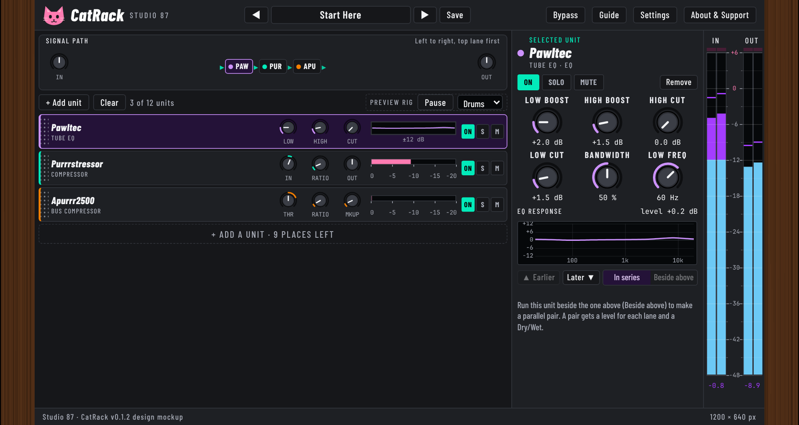

# CatRack

A free, open source, cat-themed rack plugin (VST3): up to 12 effect units from our plugin suite in one window, in any order, with parallel pairs, bypass, solo and mute per unit, dB meters, and chain presets.

The real plugin window, rendered offscreen by the compiled editor in CI. More pictures are in <code>docs/tour/</code>.

## Status
Test build (v0.1.1, pre-release). 28 of the 31 units shown in the design mockup are built in; the other three are listed with the reason in [ROADMAP.md](ROADMAP.md). 23 factory chains. The units run as built-in code (the pure C++ cores of our plugins); CatRack never loads other plugin files. Not yet listened to by ear or tried in real DAWs. Downloads are on the [Releases page](https://github.com/SpeakingColors/CatRack/releases).

## Use
Press **+ Add unit**, pick a unit, tweak its six controls in the panel on the right, drag units by the grip to reorder, drop one on the middle of another to run them side by side. Press **B** to bypass. Every control has a hover info bubble. The window resizes from every edge and corner; double-click the wood to go back to 100%.

## Tests
`sh tests/run.sh` runs the core tests without JUCE (latency equals the sum of the rows, stability on every unit, state round trip). CI also builds on Windows, macOS and Linux, runs pluginval and renders the real editor.

## Privacy
Collects nothing. No network access.

## Support

  

Free and open source, made by one person. If it helps your music, a coffee on [Ko-fi](https://ko-fi.com/studio87) keeps it coming.

## License
AGPL-3.0-or-later, see [LICENSE](LICENSE).
